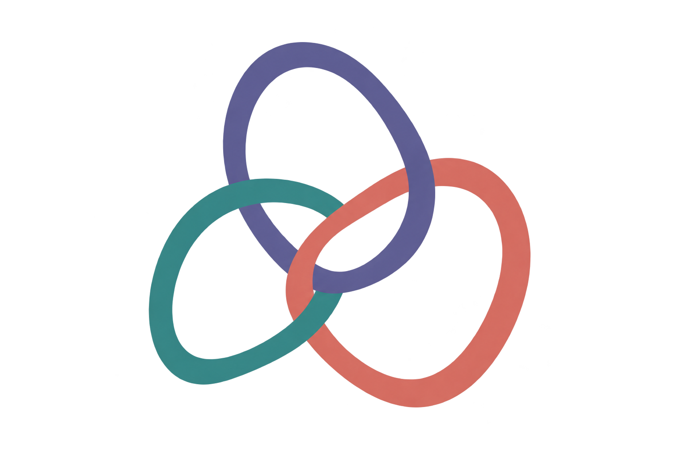

# Universal representations

[](https://arxiv.org/abs/2605.13675)
[](https://arxiv.org/abs/2605.13675)
[](https://github.com/florianmahner/pysrf)

Code for [Characterizing Universal Object Representations Across Vision Models](https://arxiv.org/abs/2605.13675), accepted at NeurIPS 2026. We extract nonnegative dimensions from 162 vision models and measure how consistently they recur across models.

## Citation

Please cite our paper if you use this code. Citation metadata are in [CITATION.cff](CITATION.cff), also available through **Cite this repository** on GitHub.

## Getting non-negative embeddings

The factorization is provided by **[pysrf](https://github.com/florianmahner/pysrf)**, our library for **Similarity-based Representation Factorization**. Use it directly to extract nonnegative dimensions from your own similarity matrices:

```python
from pysrf import SRF

weights = SRF(rank=50, random_state=42).fit_transform(similarity)
```

Here, `similarity` is a symmetric, nonnegative similarity matrix. The fitting settings used in this paper are in [`config.yaml`](config.yaml).

## Installation

Python 3.10+ and a C compiler are required. Installation includes `pysrf` from a fixed GitHub commit.

```bash
git clone https://github.com/florianmahner/universal-representations.git
cd universal-representations
python -m venv .venv
source .venv/bin/activate
pip install -e ".[test]"
pytest -q
```

The tests run on synthetic data. Install `.[features]` for feature extraction, `.[analysis]` for semantic-label and AligNet analyses, or `.[reports]` for cluster reports. CLIP and Detectron2 require separate installation.

## Usage

Fit embeddings for a model from its extracted features:

```bash
python -m experiments.factorization.fit.run_grid 'models=[torchvision_resnet50_imagenet1k_v2]'
```

Once embeddings are available for the model cohort, compute universality scores:

```bash
python -m experiments.universality.metric.compute.run data_root=/path/to/data
```

Instructions for each analysis:

- [Feature extraction](experiments/feature_extraction/)
- [SRF and bandwidth selection](experiments/factorization/)
- [Universality and downstream predictions](experiments/universality/)
- [Controls and additional analyses](experiments/rebuttal/)
- [Human dimension ratings](experiments/human_ratings/)

## Data

Model and image metadata are in [`data/meta`](data/meta/). Aggregated human ratings are in [`dimension_ratings.csv`](data/ratings/dimension_ratings.csv). Images, features, model weights, embeddings, neural recordings, behavioral triplets, and participant-level ratings are stored separately.

Set `data_root` in [`config.yaml`](config.yaml). The expected layout is:

```text
data/
├── images/<dataset>/<category>/<image>
├── features/{things22k,objectnet}/<model>.npy
├── features/macaque/22k/processed/{F,N}.npy
├── embeddings/<dataset>/<model>/rank_<k>/sigma_<m>/seed_<s>/w.npz
├── behavior/things_triplets/
├── ratings/
└── meta/
```

Feature and embedding rows follow the image metadata CSV for each dataset.

## License

[BSD-3-Clause](LICENSE). See [third-party notices](THIRD_PARTY.md).
